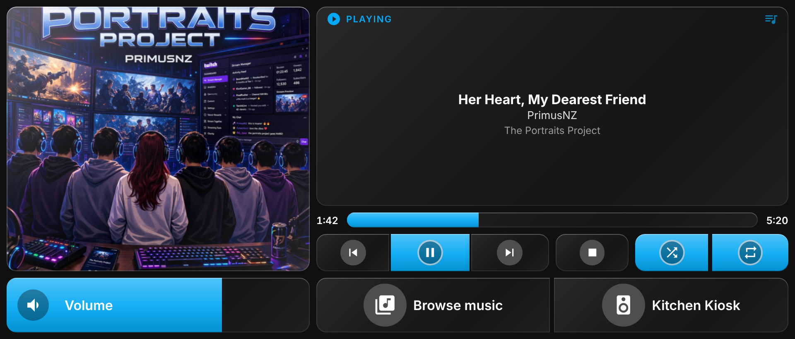
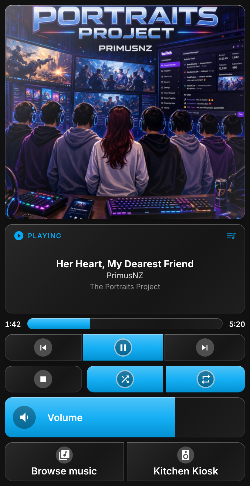
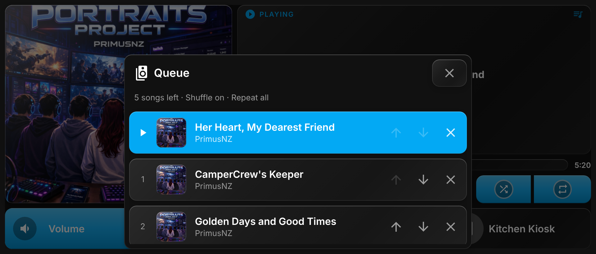
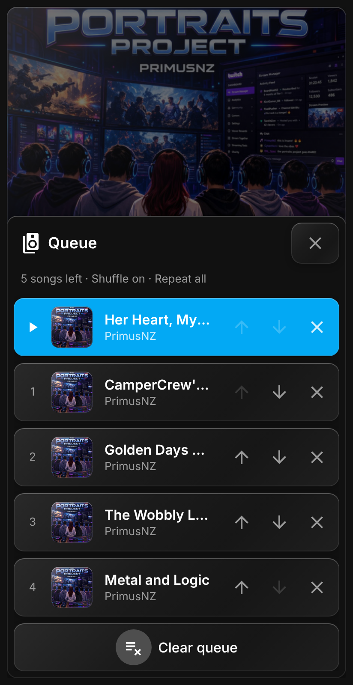
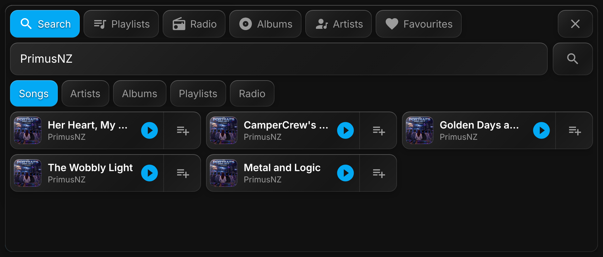
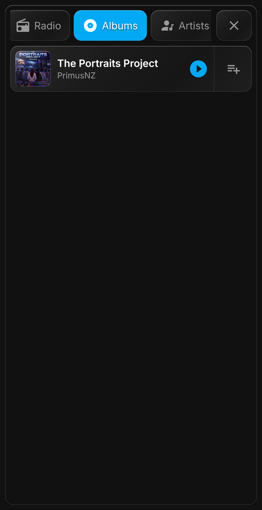
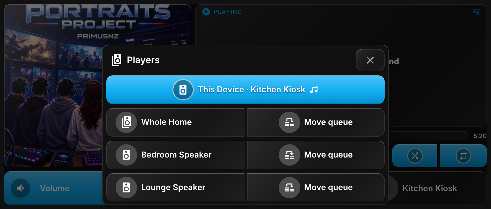
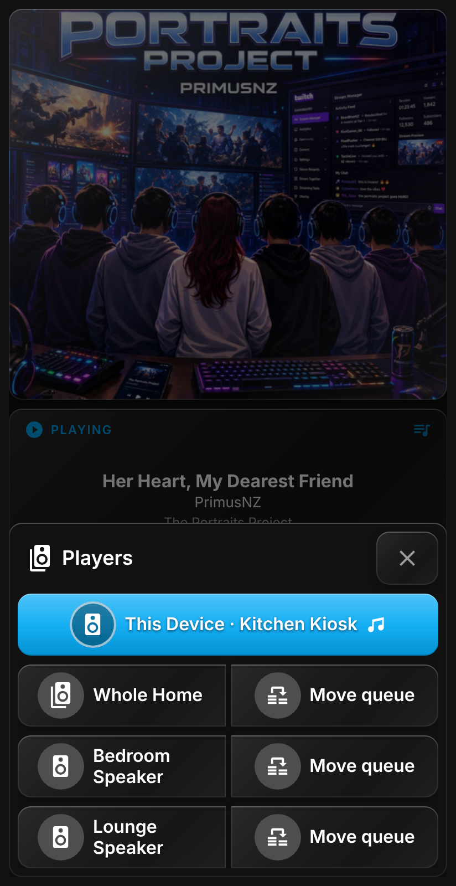
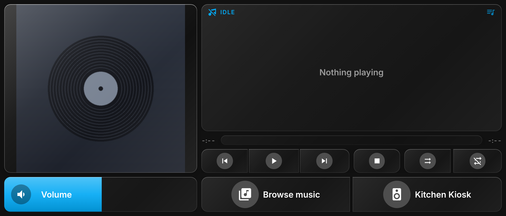
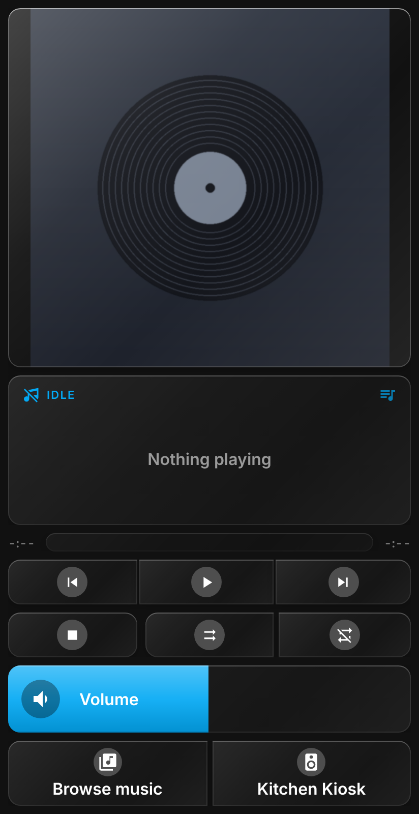

# Touch Media Card

A music player card for Home Assistant that is easy to use by touch, made for wall tablets and similar screens. It draws all of its own buttons, so you do not need any other custom cards. It works with [Music Assistant](https://music-assistant.io/) players and lets you search and browse your music and see the whole queue.

[](#) [](#) [](LICENSE)

<br>



<br>

## Table of contents

**[`Features`](#features)**  **[`Screenshots`](#screenshots)**  **[`Installation`](#installation)**  **[`Configuration`](#configuration)**  **[`Templates`](#templates)**  **[`Full queue view`](#full-queue-view)**  **[`Styling`](#styling)**  **[`Notes`](#notes)**  **[`License`](#license)**

<br>

## Features

- Wide screens: big album art on the left with a volume bar under it. The song details, progress bar and playback buttons are on the right, with Browse music and the player picker along the bottom.
- Tall screens (portrait): the album art sits above the controls.
- Song, artist and album, and whether the music is playing, paused or stopped.
- Progress bar with the time played and the total time. Drag it to jump to another point in the song, if the player allows it.
- Volume bar. The speaker icon at its left mutes and unmutes. The percentage shows while you change the volume and then fades, or stays on screen if you turn on `always_show_volume`.
- Previous, play and pause, next, stop, shuffle and repeat. Stop also clears the queue.
- Browse music: search, playlists, radio, albums, artists and favourites from Music Assistant.
- Queue: tap the song details to see what is coming up. You can play, move or remove songs, or clear the queue.
- Player picker: choose which player to show and control, and move the queue from one player to another.
- Optional automatic switching: when a main player (for example a whole-home speaker group) starts playing, the card shows it.
- Optional picture for when nothing is playing, using `idle_image`.
- A glass look, on by default (turn it off with `glass: false`).
- A visual editor, so you can add and change the card from the dashboard without writing any YAML.

<br>

## Screenshots

| Wide screen | Tall screen |
| --- | --- |
|  |  |
|  |  |
|  |  |
|  |  |
|  |  |

<br>

## Installation

**What you need:**

- Home Assistant with the [Music Assistant](https://www.home-assistant.io/integrations/music_assistant/) integration. Browsing, moving the queue and the queue list need it. The basic playback buttons work with any media player.
- Nothing else. The card draws its own buttons and volume bar.

<details>

<summary>Without HACS</summary>

<br>

1. Download this file: [touch-media-card.js](https://raw.githubusercontent.com/PrimusNZ/touch-media-card/main/touch-media-card.js)
2. Put the file in your `<config>/www/touch-media-card` folder.
3. On your dashboard, click the three dots at the top right, then `Edit dashboard`.
4. Click the three dots again, then `Manage resources`.
5. Click `Add resource`.
6. Paste this: `/local/touch-media-card/touch-media-card.js?v=1`
7. Choose `JavaScript Module`, then click `Create`.
8. Go back and refresh the page.
9. Click `Add card` in the bottom right corner and search for `Touch Media Card`.
10. After you update the file, edit the resource address and change the number after `?v=` to a higher one so your browser loads the new copy.

If it does not work, try clearing your browser cache.

</details>

<details>

<summary>With HACS (recommended)</summary>

<br>

This way you get updates straight from the Home Assistant Community Store.

1. If HACS is not installed yet, follow the steps at [https://hacs.xyz/docs/use/download/download/](https://hacs.xyz/docs/use/download/download/).
2. Finish the first-time HACS setup: [https://hacs.xyz/docs/configuration/basic](https://hacs.xyz/docs/configuration/basic).
3. Open "HACS" in the sidebar.
4. Click the blue button below (or add `https://github.com/PrimusNZ/touch-media-card` as a custom repository of type `Dashboard`).
5. Click "Download".
6. Go back to your dashboard, click the three dots at the top right, then `Edit dashboard`.
7. Click `Add card` in the bottom right corner and search for `Touch Media Card`.

If it does not work, try clearing the browser or app cache (on every device if needed).

</details>

<br>

[](https://my.home-assistant.io/redirect/hacs_repository/?owner=PrimusNZ&repository=touch-media-card&category=frontend)

<br>

## Configuration

You can set everything up with the visual editor. If you prefer YAML, this is a small example:

```yaml
type: custom:touch-media-card
entity_id: media_player.kitchen_display
priority_player: media_player.whole_home_audio
priority_name: Whole Home
discover: true
```

<details>

<summary><b>All options</b></summary>

| Name | Type | Requirement | Default | Description |
| --- | --- | --- | --- | --- |
| `type` | string | **Required** | | `custom:touch-media-card` |
| `entity_id` | string | Optional | none | The player that belongs to this screen. It appears as **This Device** in the player picker and is chosen when it starts playing. Can be a [template](#templates). |
| `priority_player` | string | Optional | none | A player the card switches to whenever it starts playing, such as a whole-home speaker group. Leave it out and the card never switches to it automatically. You can still pick it by hand. Can be a [template](#templates). |
| `priority_name` | string | Optional | the player's own name | The label shown for the priority player. |
| `discover` | boolean | Optional | `true` | `true` lists every Music Assistant player and ignores `media_players`. `false` lists only the players in `media_players`. |
| `media_players` | list | **Required** if `discover` is `false` | none | The players to offer when `discover` is `false`. Each entry can be a [template](#templates). The card shows an error if the list is empty. |
| `config_entry_id` | string | Optional | found automatically | The Music Assistant entry ID. The card finds it by itself. Only fill this in if you use a non-admin account, which cannot look it up. |
| `ma_url` | string | Optional | none | The address of your Music Assistant server, for example `http://192.168.1.10:8095`. Together with `ma_token` it turns on the [full queue view](#full-queue-view). |
| `ma_token` | string | Optional | none | A Music Assistant access token. |
| `glass` | boolean | Optional | `true` | The glass look: a see-through surface and edge on the tiles, and a soft shine on the progress and volume bars, the highlighted buttons, the selected player, the album art and the small pictures. Set `false` for plain tiles. |
| `always_show_volume` | boolean | Optional | `false` | Keep the volume percentage showing on the volume bar instead of letting it fade out five seconds after the last change. |
| `idle_image` | string | Optional | none | The address of a picture to show in the album art tile when there is no cover art (nothing playing, or no player), for example `/local/my-images/idle.png`. It is shown whole and centred, not cropped. |

If you set neither `entity_id` nor a usable `priority_player`, the card shows the first player it finds (preferring one that is playing) until you pick another.

</details>

<details>

<summary><b>Without automatic discovery</b></summary>

```yaml
type: custom:touch-media-card
entity_id: media_player.kitchen_display
discover: false
media_players:
  - media_player.kitchen_display
  - media_player.office_speaker
  - media_player.living_room_tv
```

</details>

<br>

## Templates

`entity_id`, `priority_player` and each entry in `media_players` can be a short `[[[ ]]]` template instead of a fixed name. The card works out the answer each time. This is useful when one dashboard is shown on several screens and each screen needs its own player.

```yaml
type: custom:touch-media-card
priority_name: Whole Home
priority_player: '[[[ return states["input_text.whole_home_player"].state ]]]'
entity_id: '[[[ return states["input_text.kitchen_display_player"].state ]]]'
discover: true
```

Inside the brackets you can use `hass`, `states` and `user`. If your template has no `return`, it is treated as a single expression. The card does not read anything else from your dashboard. Anything a template needs comes from Home Assistant itself or from your own dashboard.

<br>

## Full queue view

Home Assistant only shows the song playing now and the next one. If you add `ma_url` and `ma_token`, the card talks to your Music Assistant server directly, so it can show the whole queue and let you play, move or remove songs.

```yaml
type: custom:touch-media-card
entity_id: media_player.kitchen_display
ma_url: https://music.example.com
ma_token: YOUR_TOKEN
```

- The token is saved in your dashboard settings, so anyone who can open the dashboard can read it. Make a token just for this card.
- The screen itself contacts the server, so the server must be reachable from the screen and must allow requests from your Home Assistant address (this is called CORS). If you use a reverse proxy, add the CORS settings for `/api` there.
- Without these two options, or if the server cannot be reached, the card shows only the current and next song.

<br>

## Styling

The card follows your Home Assistant theme: `--ha-card-background` for tile backgrounds, `--primary-color` for highlights and `--primary-text-color` and `--secondary-text-color` for text. You can change any of the following colours and sizes in your theme or on the card (for example with [card-mod](https://github.com/thomasloven/lovelace-card-mod)):

| Name | What it changes |
| --- | --- |
| `--kiosk-surface` | Background of buttons, song details and pop-up sheets |
| `--kiosk-surface-edge` | Shadow around those tiles (none by default) |
| `--kiosk-accent` | Active buttons, the filled part of the bars, and highlights |
| `--kiosk-text-primary` / `--kiosk-text-secondary` | Text |
| `--kiosk-background` | Background of the browser and pop-up sheets |
| `--kiosk-viewport-content-height` | Card height (by default the full height of the space it is in, at least 300px) |
| `--kiosk-border-radius-12px` | Corner roundness (12px by default) |

The card fills the height of the space it is placed in, so give it room, for example in a panel view or a full-height section. On tall screens it puts the artwork above the controls.

<br>

## Notes

- From version 2.0.0 the card no longer needs Bubble Card. You can remove Bubble Card if nothing else on your dashboards uses it.
- Tested on Home Assistant with Music Assistant players, including a small touch screen (about 800 by 400 pixels). Other setups may need small adjustments.

<br>

## License

Copyright © 2026 Ryan Davies (PrimusNZ).

This project is licensed under the [MIT License](LICENSE).
